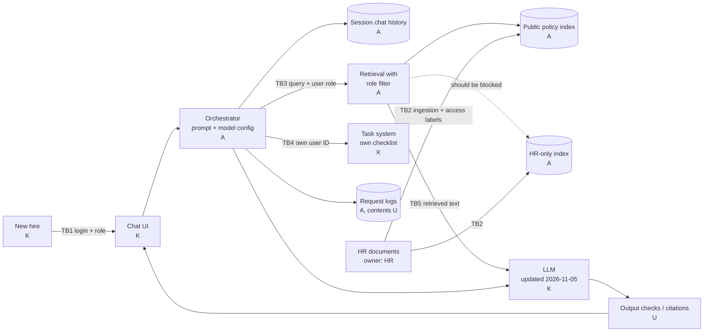

# AI System Map

## System Context

- **System:** HR-onboarding assistant: a chat assistant that guides new hires
  through onboarding tasks and HR policies. *(team choice)*
- **Primary user:** New hire in their first ~30 days. *(team choice)*
- **Task or decision supported:** Answers HR policy questions from HR documents
  and shows the new hire's **own** onboarding checklist from the task system.
  Read-only: it takes no actions. Supports the decision "what do I need to do
  next, and what does the policy say?" *(team choice)*
- **Expected outcome:** The new hire gets a correct, sourced policy answer and
  sees only their own tasks and data, which means fewer questions to HR.
- **Unacceptable outcome:** The assistant returns **any information the user is
  not authorized to see under HR access rules**, for example another employee's
  salary, contract, health, performance or private contact details, or
  documents restricted to HR/managers. *(team choice: broad rule; the examples
  are test anchors)*
- **Accountable owner:** HR product owner (People-Tech). *(team choice)*
- **Affected people:** New hires (users); employees whose data could be
  exposed; HR team; data protection officer (DPO). *(team choice)*

## Request Flow

Map the path from user request to response or action. Include the interface,
application logic, context, model, tools, validation, and fallback that matter
for this system.

> Labels: **K** = known (team choice / case fact), **A** = assumption, **U** = unknown.
> TB1–TB5 mark trust boundaries (lesson 03: "Mark the Trust Boundaries").

## Data and Knowledge Flow

| Data or content | Source and owner | Processing or storage | Used when | Freshness requirement |
|---|---|---|---|---|
| Public HR policies (incl. published salary bands) | HR | Parsed, chunked, labelled → public policy index (**A**) | Policy questions | Current version only |
| HR-only documents (e.g. `Compensation_Overview_Analytics_2026.pdf`, synthetic) | HR | Separate HR-only index (**A**); how access labels are set is **U** | Should never be used for new-hire queries | Current; strictly access-controlled |
| Onboarding checklist | Task system / People-Tech | Read via API, scoped to the user's ID (**K** scope, **A** mechanism) | "Show my tasks" | Live |
| User identity and role | SSO / HR system | Passed with each request (**A**) | Every request; used by the retrieval filter (**A**) | Live |
| Session chat history | Assistant | Per session only, no long-term memory (**A**) | Follow-up questions | Session lifetime |
| Request logs | People-Tech | Request/response stored (**A**); retrieved chunks and filter decisions **U** | Investigation | Retention **U** |

## Components and Responsibilities

| Component | Responsibility | Input | Output | Owner | Known or assumed? |
|---|---|---|---|---|---|
| Chat UI | Capture question, show answer + citations | User text, SSO session | Rendered answer | People-Tech | K |
| Orchestrator | Build prompt, call retrieval, task system and LLM | Question, user role, history | Model request | People-Tech | A |
| Retrieval + role filter | Find relevant passages the user may see | Query + role | Ranked passages | People-Tech | A (filter assumed by team) |
| Public / HR-only indexes | Store document chunks, separated by audience | Ingested HR docs | Searchable chunks | People-Tech (tech), HR (content) | A |
| Ingestion | Parse docs, attach access labels, route to an index | HR uploads | Indexed chunks | People-Tech + HR | A; labelling process U |
| Task system | Return the user's own checklist | User ID | Task list | People-Tech | K (read-only) |
| LLM | Generate answer with citations | Prompt + passages | Answer text | External provider (**A**) | K: updated 2026-11-05 |
| Output checks | Validate citations / block sensitive data | Draft answer | Final answer | People-Tech | U: may not exist |
| Logs | Record requests for audit | Request/response | Log records | People-Tech | A |

## Trust Boundaries and Permissions

| Boundary | Data or authority crossing it | Required control | Failure impact |
|---|---|---|---|
| TB1 User → UI | Identity and role | SSO authentication; correct role mapping | Wrong role → wrong data allowed |
| TB2 HR docs → indexes | Private documents and their access labels | Correct audience label + routing to the right index | HR-only doc lands in the public index or is mislabelled |
| TB3 Orchestrator → retrieval | Query + user role | Filter by permissions **before** retrieval (lesson 03) | Restricted passages reach the model |
| TB4 Orchestrator → task system | User ID | Query scoped to own ID | Another person's tasks shown |
| TB5 Retrieved text → LLM context | Passages, possibly sensitive | Only authorized text enters; the prompt is **not** an authorization boundary (lesson 03) | Model repeats restricted data, as in our case |

## Human Oversight and Recovery

- **When must a person review or approve?** No review before answers are shown
  (read-only Q&A, **A**). HR reviews documents before upload (**A**).
- **How can the user challenge or correct an output?** Only by contacting HR,
  which is how Sam reported it (**K**). No in-app report button (**A**).
- **What fallback exists when AI or a dependency fails?** The HR inbox (**A**).
- **Which actions can be reversed?** The assistant takes no actions. Document
  removal and filter changes are reversible. **Exposure itself cannot be undone.**

## Architecture Unknowns

| Unknown | Why it matters | Best source or owner to clarify it |
|---|---|---|
| Is the role filter actually applied at retrieval, and on which index? | Our assumption; the central control for this failure | People-Tech engineering |
| How access labels are set at ingestion, and how the doc got its label/index | Explains how an HR-only doc became retrievable | HR content owner + ingestion engineer |
| Did the prompt/model update change orchestration (e.g. which indexes are queried)? | Separates "update caused it" from coincidence (C2) | People-Tech release owner |
| Do output checks exist? | A second line of defence that evidently didn't catch it | People-Tech engineering |
| What do logs contain (retrieved chunks, filter decisions)? | Decides whether we can reconstruct the request | People-Tech engineering |
| Sam's role mapping in SSO | A wrong role would let a correct filter allow wrong docs | IT / identity team |

## Evidence We Would Request

Smallest useful set (handout §3), in priority order:

| Evidence request | What it could reveal |
|---|---|
| 1. Re-run Sam's exact question as a test new-hire account | Whether the failure reproduces |
| 2. Log/trace of the 2026-11-12 request: retrieved passages, source index, filter applied, user role | Where the restricted text entered |
| 3. Access label and index location of `Compensation_Overview_Analytics_2026.pdf` (synthetic) | Ingestion/labelling error vs retrieval error |
| 4. Diff of the 2026-11-05 prompt/model/config release | Whether the update touched retrieval or permission logic |
| 5. Sam's role as resolved by SSO at request time | Identity/role-mapping error |
